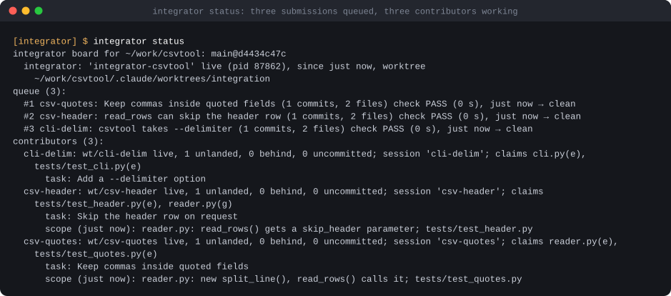
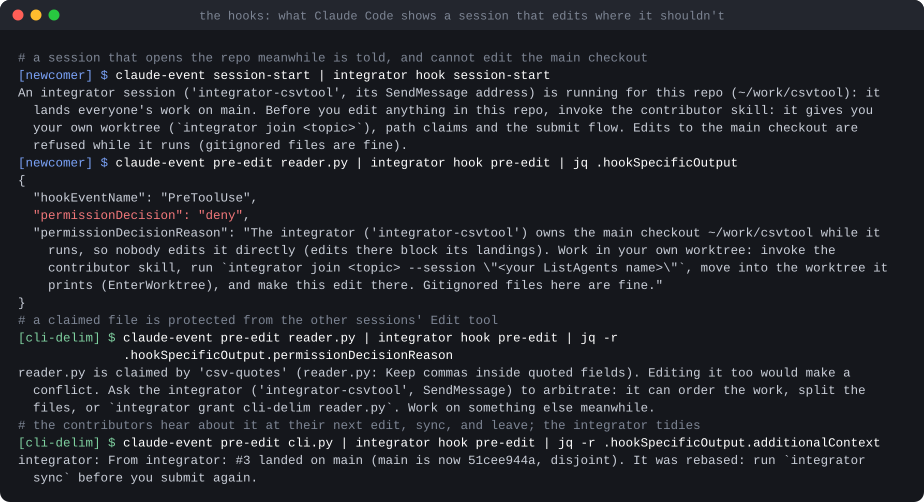
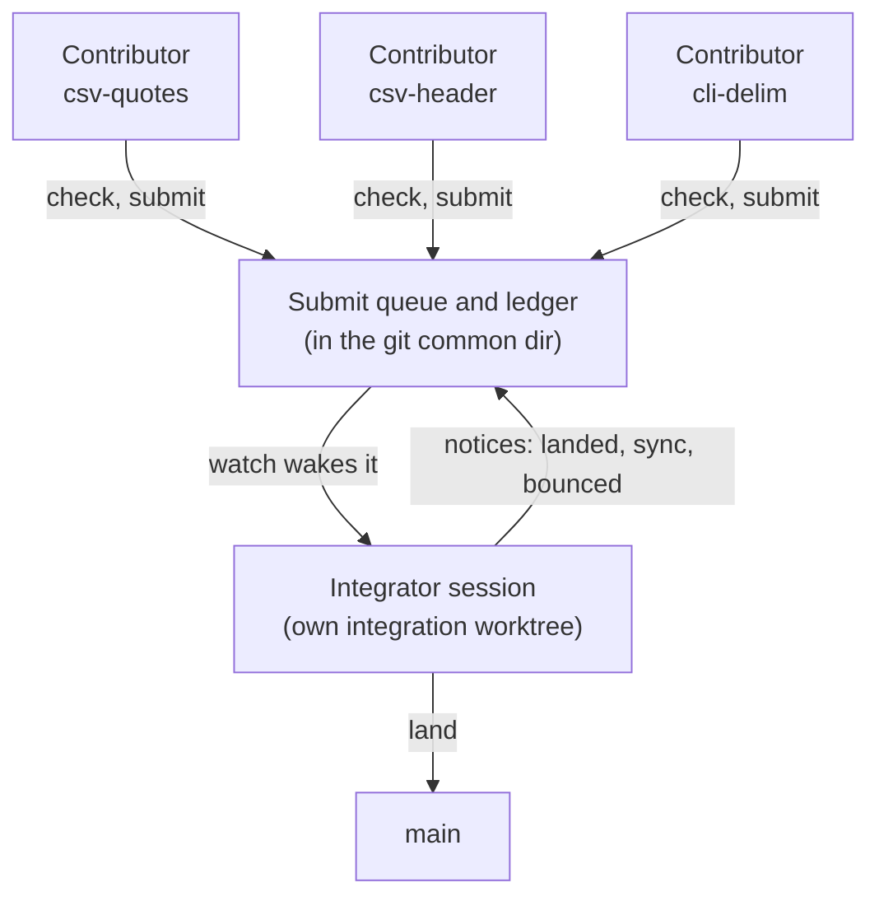
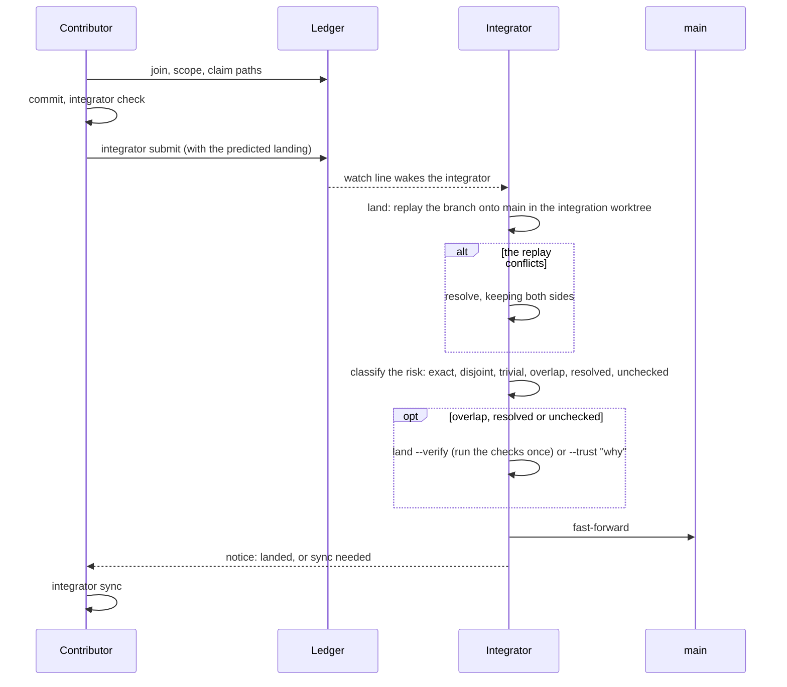

# integrator

**Run several Claude Code sessions on one repo at once. One of them, the integrator, lands everyone's work.**



<sub>A real run of [`docs/demo/run-demo.sh`](docs/demo/run-demo.sh) on a throwaway repo: three contributors changed a small CSV tool at once, two of them in the same lines. Each prompt names the session that ran the command; the `[exit N]` lines are the CLI's exit status (3 = a landing conflict, 4 = it needs verification). The full session is in [`docs/data/demo-session.txt`](docs/data/demo-session.txt); the temporary directory is shown as `~/work`. The sessions are stand-ins (shells carrying the variables Claude Code sets), so no Claude Code session or model ran.</sub>

Parallel agents are easy to start and hard to merge. Several sessions in one checkout overwrite each other's edits; several on separate branches leave a pile of conflicts for a person to sort out at the end. `integrator` turns that into a protocol. Every session works in its own git worktree and branch, says what it will touch, checks its own work and submits small units. One more session, the **integrator**, is the only one that writes `main`: it lands the queue, rebases and resolves conflicts in a worktree of its own, and spends a test run only on the landings its contributors' checks don't already cover. Claude Code hooks keep everyone inside the protocol: no edits in the main checkout, none inside another session's claim, and the integrator's notices arrive with the next edit.

It is a Python CLI (standard library plus git), two Claude Code skills and two agents. Developed and tested on an Apple Silicon Mac; the demo and the tests need no model.

## Try it (no Claude Code needed)

```bash
git clone https://github.com/mthomas100/integrator && cd integrator
docs/demo/run-demo.sh                        # ~10 s: a throwaway repo, an integrator, three contributors, a real conflict
python3 -m unittest discover -s tests        # 29 end-to-end tests, about a minute
```

The demo needs bash, git 2.40+, Python 3.11+ and `jq`. It runs in a temporary directory that it removes when it ends, with its own empty home and no access to your git config, so nothing of yours is touched. Its commit ids repeat from run to run; the pids and the check-log timestamps don't.

## What it looks like

`integrator status` is the board everyone shares: the queue, with the check result and the predicted landing of each submission, and every contributor's branch, claims, task and scope.



The hooks are what make the protocol hold when nobody is watching. This is what a session is shown when it opens the repo while an integrator runs, when it edits in the main checkout, when it edits a file another session claimed, and when the integrator's notice reaches it:



## How it works



One landing, from a contributor's submit to its notice:



- **Contributors** (any number of sessions) each work in their own git worktree and branch. Once they know their plan they put their scope on the board (`integrator scope`) and claim the paths they'll change. When two contributors' work meets, they agree the seam with each other directly and tell the integrator in one line. They commit small units, check them (`integrator check`) and submit them (`integrator submit`), then tell the integrator (SendMessage) and go straight on to the next unit. When everything has landed they leave and end their last message with `🏁 SAFE TO CLOSE: <topic>, all landed (...)`, so the person running them knows which sessions can be closed.
- **The integrator** (one session per repo) is the only one that writes `main`. It lands submissions as they arrive: a fast-forward when nothing moved, otherwise a rebase in its own integration worktree, never in a contributor's. It resolves conflicts there and tells the contributors whose files moved to sync. It runs the checks itself only when the contributor's own don't cover what lands. Between landings it trial-merges every branch against main and against the others (`integrator conflicts`, using `git merge-tree`, no working tree) and warns both owners the moment two branches head for the same lines. It facilitates rather than manages: it hands out id ranges, reads each scope as it arrives, and introduces the contributors whose work meets so they settle the seam between themselves.
- **Hooks** keep everyone honest. While an integrator runs, nobody else edits the main checkout, nobody edits inside another contributor's exclusive claim, and each contributor's next edit carries the integrator's notices ("sync now", "#12 landed", "bounced: ..."). A new session in the repo is told on start that an integrator runs.

The procedures themselves are Claude Code skills, so the agents follow them rather than improvising: [`skills/integrator`](skills/integrator/SKILL.md) (what to do on each wake-up, the decision tables for NEEDS-VERIFY, how to resolve a conflict, how to bring neighbours together) and [`skills/contributor`](skills/contributor/SKILL.md) (join, scope, claim, small checked units, listen, sync, leave). [`agents/integrator.md`](agents/integrator.md) is the agent behind `claude --agent integrator`; [`agents/contributor.md`](agents/contributor.md) is a subagent type for in-process contributors.

## How a landing is judged

`integrator land next|all` classifies each submission by how well its author's own check covers what would land:

| Risk | Meaning | Lands without the integrator checking? |
|---|---|---|
| `exact` | the landed tree is the very tree the contributor's check passed on (a fast-forward) | yes |
| `disjoint` | main moved, but only in files this submission didn't change | yes (the accepted risk: a semantic coupling across files) |
| `trivial` | docs only (`trivial` globs), or overlaps only there | yes |
| `overlap` | main also changed some of the same files (it rebased cleanly) | no: **NEEDS-VERIFY** |
| `resolved` | the integrator resolved a conflict by hand | no: NEEDS-VERIFY |
| `unchecked` | submitted with `--no-check` and not docs-only | no: NEEDS-VERIFY |

On NEEDS-VERIFY the integrator chooses `land --continue --verify` (run the checks once, in its worktree, for the whole batch), `--continue --trust "<why>"`, or `--abort` and `bounce` the submission to its author for a sync and re-check. The integrator skill has the decision table. In the demo above, #1 lands `exact`, #3 lands `disjoint` after a rebase, and #2 is `resolved` and so is verified: the checks run once on the combined tree before `main` moves.

## Install

Requirements: Python 3.11+ (`tomllib` reads `.integrator.toml`), git 2.40+ (`git merge-tree --write-tree --merge-base`), and Claude Code. The CLI uses `fcntl`, so it is for macOS and Linux; it has only been run on macOS so far. `integrator launch` opens iTerm2 panes and is macOS-only (`--bg` and `--print` don't need iTerm).

```bash
./install.sh             # once per machine, idempotent
./install.sh --uninstall # takes all of it out again
```

`install.sh` links `integrator` into `~/.local/bin` (put that on your `PATH`), the two skills into `~/.claude/skills`, the two agents into `~/.claude/agents`, and adds two hooks to `~/.claude/settings.json` after saving a timestamped backup next to it: `SessionStart` (`integrator hook session-start`) and `PreToolUse` on `Edit|Write|MultiEdit|NotebookEdit` (`integrator hook pre-edit`). The hooks call this checkout wherever it lives, so run `./install.sh` again if you move it. In a repo with no live integrator they exit at once: about 33 ms per call at the median in 30 runs on an Apple Silicon Mac with Python 3.15, of which about 22 ms is Python starting. Any error in a hook is swallowed (a one-line trace goes to `~/.integrator-hook-errors.txt`) and the edit goes ahead.

## Use it

```bash
cd ~/code/myapp                      # the main checkout
integrator launch integrator         # the integrator session, in an iTerm pane (claude --agent integrator)
integrator launch contributor csv-fix "Fix the quoted-field bug in the CSV reader"   # one per parallel task
```

Or, in any session you already have open: "be the integrator" (the `integrator` skill) or "invoke the contributor skill and do X" (the `contributor` skill). `integrator status` shows the board; `integrator help` lists every command.

### Launching sessions and permissions

`integrator launch` starts `claude` sessions with whatever `launch_flags` you set in `.integrator.toml`, and by default that is nothing: they use Claude Code's normal permission prompts. A team that runs unattended needs its tools pre-approved, either in your Claude Code permission settings or, bluntly, with `launch_flags = "--dangerously-skip-permissions"`, which switches the prompts off for every session `launch` starts. Do that only in a disposable VM, container or throwaway clone. Keep all the sessions in the same permission mode either way: Claude Code holds a cross-session message for approval when the receiver is in a different mode (see Messages below).

## Settings: `.integrator.toml` in the main checkout (all optional)

```toml
main = "main"                         # the branch the integrator owns (default: the main checkout's branch)
check = "scripts/check.sh"            # the repo's checks; contributors must pass them before submitting
worktree_root = ".claude/worktrees"   # where contributor worktrees go ("..": siblings named <repo>-wt-<topic>)
branch_prefix = "wt/"
shared = ["CHANGELOG.md", "docs/decisions.md"]   # hotspots: claims there are always shared, never exclusive
conflict_hint = "keep both: scripts/keep-both.py {files}"   # printed after every sync or landing conflict
trivial = ["*.md", "docs/**"]         # changes that need no check, and overlaps that need no verification
setup = ""                            # a command run in each new contributor worktree
launch_flags = ""                     # extra flags for the sessions `integrator launch` starts (see above)
[quick]                               # fast checks run at EVERY landing touching these paths, trivial ones too
"docs/decisions.md" = "python -m pytest -q tests/test_decisions.py"
[verify]                              # extra checks when a change touches these paths and the integrator verifies
"frontend/" = "cd frontend && npm run build"
```

The `check`, `setup`, `[quick]` and `[verify]` commands run through a shell (`shell=True`), so treat `.integrator.toml` like a Makefile: only use one you have read.

## Where things live

- `<git common dir>/integrator/` holds `state.json` (integrator, contributors, claims, the queue, check results, notices), `events.jsonl` (what `integrator watch` streams) and `checks/` (check logs). Every worktree shares the common dir, and nothing there is committed.
- `bin/integrator` (a fast launcher for the hooks) and `bin/integrator_cli.py` (everything else, Python 3 standard library).
- `skills/integrator`, `skills/contributor`: the two roles' procedures. `agents/integrator.md` is the agent for `claude --agent integrator`; `agents/contributor.md` is a subagent type for in-process contributors.
- `docs/demo/`: the demo script and its event helper. `docs/charts/make_terminal_svg.py`: turns the captured transcript into the animated SVGs above (stdlib only). `docs/data/demo-session.txt`: the captured session the images are drawn from.

## Messages

Sessions talk through Claude Code's cross-session messaging (SendMessage to a ListAgents name, delivered at the receiver's next tool call). Two limits shaped the design:

1. A session in a different permission mode from the sender **holds** cross-session messages for its user's approval (`crossSessionInbound`). Run the team's sessions in the same mode (`integrator launch` gives all of them the same `launch_flags`).
2. A subagent can't receive them, because replies go to its parent session.

So everything that must not be lost also goes through the ledger. Submissions and questions wake the integrator through `integrator watch`. Notices for a contributor arrive with its next edit (the pre-edit hook) or its next `integrator status --me`.

## Tests

`python3 -m unittest discover -s tests -v`: 29 end-to-end tests, each in a throwaway repo, with the sessions told apart the way Claude Code tells them apart (`CLAUDE_CODE_SESSION_ID` and `CLAUDE_PID`). They cover fast-forward, disjoint rebase, overlap and verify, conflict resolution, abort and bounce, sync after a rebased landing, resubmit, main moving outside the protocol, merge-tree prediction, claims, scope, the hooks, the repo's conflict hint, quick checks, leave and prune.

## Limitations and status

- **Early.** Written over two days in November 2026 and used live so far on one app repo. Still to do: a full day with several contributors, and a measurement of message delivery between sessions in different permission modes.
- **The tests stand in for sessions.** They never start Claude Code, so SendMessage delivery, Monitor wake-ups and the skills' behaviour under a real model are exercised only by use, not by the suite.
- **The hooks guard Claude Code's edit tools.** A shell command that writes files (`sed -i`, `>`) is not stopped, so claims are advisory there; `integrator conflicts` still reports the overlap afterwards.
- **Ids numbered across branches can collide.** Two unlanded branches can both take the next decision or ticket number. Today the integrator hands out ranges by hand (see the skill); a per-repo rule that `submit` and `conflicts` check against every registered branch is not built.
- **Platform.** macOS only for `launch` (iTerm2 and AppleScript); untested on Linux; not for Windows.

## Credits and licence

MIT, see [LICENSE](LICENSE). Built for [Claude Code](https://claude.com/claude-code), which is Anthropic's product; this is an independent project and isn't affiliated with or endorsed by Anthropic. There is no third-party code or media in the repository, and no AI-generated imagery: the images are drawn from real command output by `docs/charts/make_terminal_svg.py`.
